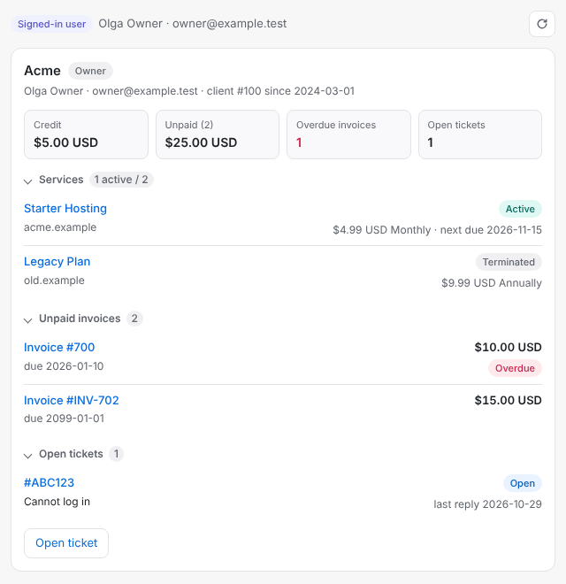
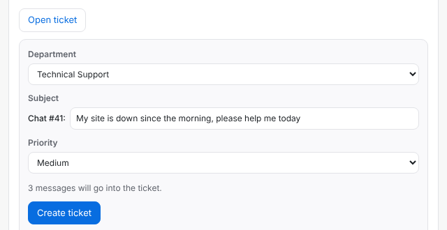

# Chatwoot by inSave Hosting

A free WHMCS addon that connects [Chatwoot](https://www.chatwoot.com) live chat to your billing:

- the Chatwoot chat widget in the WHMCS client area, with the logged-in client recognised by name and email;
- a **WHMCS card** inside Chatwoot, so an agent sees the client's services, unpaid invoices and open tickets next to the conversation;
- a **ticket from chat**: one button turns a conversation into a WHMCS ticket with the transcript.

Open source (MIT), no licence key, no ionCube. The module talks only to your own Chatwoot.

| The WHMCS card in a conversation | Opening a ticket from a chat |
|---|---|
|  |  |

The card follows Chatwoot's light and dark theme ([dark screenshot](docs/images/card-dark.png)). The screenshots show test data.

## Contents

- [What it does](#what-it-does)
- [Requirements](#requirements)
- [Install](#install)
- [Settings](#settings)
- [WHMCS card in Chatwoot](#whmcs-card-in-chatwoot)
- [Ticket from chat](#ticket-from-chat)
- [Upgrading](#upgrading)
- [Troubleshooting](#troubleshooting)
- [Privacy](#privacy)
- [Support](#support)

## What it does

**For clients**

- The chat widget on every client area page. A logged-in client does not have to introduce themselves: Chatwoot gets their name, email and company.
- The widget speaks the language of the client area (optional).
- After a logout the chat starts clean, so the next person at the same computer does not see the previous conversation.

**For agents**

- Each WHMCS user is one Chatwoot contact. A user invited into someone else's account gets a contact of their own and never sees the owner's conversations.
- The contact carries the WHMCS user and client IDs, the number of active tickets, unpaid and overdue invoices, and the page the client is on.
- A conversation started on a service, invoice or ticket page says which service, invoice or ticket it is.
- The WHMCS card shows the account, credit, services, unpaid invoices and open tickets, each linked to the WHMCS admin area.
- "Open ticket" in the card creates a WHMCS ticket in the right department with the chat transcript.

**Safe by design**

- The client's identity is signed with your Chatwoot inbox secret (Chatwoot's identity validation), so nobody can pose as another client from the browser.
- No money amounts are sent to the browser. Agents see them only in the card, which needs a WHMCS admin login.
- An admin using "Login as Client" never chats as that client.

## Requirements

| | |
|---|---|
| WHMCS | 8.0 or later. Developed and tested on WHMCS 9.1 with PHP 8.3; earlier 8.x versions are not tested by us |
| Chatwoot | any Chatwoot with a Website inbox, self-hosted or Cloud, for the widget. Behaviour is checked against Chatwoot v4.19.1 |
| For the WHMCS card and tickets from chat | Chatwoot and WHMCS on subdomains of the same domain, for example `chat.example.com` and `billing.example.com`, both on HTTPS. In practice this means a self-hosted Chatwoot |

## Install

1. Download `chatwoot-by-insave.zip` from the [latest release](https://github.com/insavehosting/Chatwoot-WHMCS/releases/latest).
2. Unzip it and upload the `modules` folder into the WHMCS root folder. The files land in `<WHMCS>/modules/addons/chatwoot/`.
3. In the WHMCS admin area open **Addon Modules** (System Settings → Addon Modules; in older versions Setup → Addon Modules), find **Chatwoot by inSave Hosting**, press **Activate**, then **Configure**.
4. In Chatwoot open **Settings → Inboxes** and pick your Website inbox (or add one: **Add Inbox → Website**). On its **Configuration** tab:
   - copy the `websiteToken` value from the widget script;
   - under **Identity Validation** copy the secret key and turn on **Enforce user identity validation**.
5. Back in WHMCS fill in **Chatwoot URL**, **Website Widget Token** and **Secret Key**, tick **Enable Chatwoot** and save.
6. Open the client area in a private browser window. The chat bubble is in the corner; after you log in as a client and send a message, the contact in Chatwoot has the client's name and email.

Keep **Enforce user identity validation** on. Without it a visitor could claim another client's identifier and read that client's conversations.

## Settings

| Setting | What to put there |
|---|---|
| Enable Chatwoot | Turns the widget on and off |
| Chatwoot URL | The address of your Chatwoot, for example `https://chat.example.com` |
| Website Widget Token | The `websiteToken` of the Website inbox (step 4 above) |
| Secret Key | The Identity Validation key of the same inbox. It signs the client's identity and never reaches the browser |
| Chat Box Position | The bubble on the right or on the left |
| Chat Box Bubble | A round bubble (Standard) or a bubble with text (Expanded Bubble) |
| Bubble Launcher Title | The text on the expanded bubble, for example "Chat with us" |
| Enable Dark Mode on Widget | On: the widget follows the visitor's light or dark system theme. Off: always light |
| Dynamic Language | On: the widget uses the client area language, when Chatwoot has that language |
| Default non-logged In Conversation Label | A Chatwoot label for conversations of visitors, for example `visitor`. Create the label in Chatwoot first |
| Default Logged In Conversation Label | A Chatwoot label for conversations of logged-in clients, for example `client`. Create the label in Chatwoot first |
| Enable on Login as Client | On: the widget is also shown while you are logged in to the WHMCS admin area in the same browser. It is shown as for a visitor, so an admin never chats as the client. Off: no widget in that browser |
| Dashboard App Origin | Only for the WHMCS card. Leave empty unless agents open the Chatwoot dashboard at a different address than the Chatwoot URL above |
| Ticket departments | Only for tickets from chat, see [Ticket from chat](#ticket-from-chat). Empty: no ticket button |
| Access Control | The admin roles that may see the WHMCS card. With no role ticked, nobody sees it |

## WHMCS card in Chatwoot

The card is a Chatwoot "Dashboard App": a tab next to a conversation that shows the WHMCS client behind the contact.

**Set it up**

1. WHMCS → Addon Modules → Chatwoot by inSave Hosting → Configure → **Access Control**: tick the admin roles of your agents.
2. Chatwoot → **Settings → Integrations → Dashboard apps → Add a new dashboard app**. Name: for example `WHMCS`. URL: your WHMCS address followed by `modules/addons/chatwoot/app.php`, for example `https://billing.example.com/modules/addons/chatwoot/app.php`.
3. Open any conversation and switch to the new tab.

**How agents use it**

- The agent must be logged in to the WHMCS admin area in the same browser. If not, the card shows a "Log in to WHMCS admin" button; after logging in, press Reload.
- A contact who chatted while logged in to the client area is marked **Signed-in user**: this is certain.
- A contact from another channel (Telegram, WhatsApp, Facebook, email) or a visitor is looked up by email and marked **Matched by email, not confirmed**: anyone can type any email, so check before you act on it. To make such a contact certain, merge it in Chatwoot with the contact of the signed-in user (contact → Merge).
- A user with several client accounts gets a block per account.
- The round arrow reloads the data.

The card only reads WHMCS. The one thing it can create is a ticket, and only after you set up [Ticket from chat](#ticket-from-chat). It never writes to Chatwoot and stores no Chatwoot API token.

How the card is protected and what your web server needs: [docs/whmcs-card.md](docs/whmcs-card.md).

## Ticket from chat

When a chat turns into work that needs a ticket, the agent presses **Open ticket** in the card.

**Set it up**

1. Find the IDs of your support departments: WHMCS → Support Departments, the number in the address of a department's edit page (`…id=3`).
2. In the module settings fill in **Ticket departments**: `Chatwoot team=department ID`, separated by commas; `*` is a conversation with no team. Example: `sales=2,billing=4,support=3,*=1`.
3. Make sure the agents' admin role has the WHMCS permission **Open New Ticket** (Administrator Roles).

**Use it**

1. Open the conversation and the WHMCS tab, press **Open ticket**.
2. Check the department, subject and priority. The department is preselected from the conversation's team.
3. Press **Create ticket**. The card shows the ticket number, a link to it in the admin area and a link for the client with a **Copy** button, to paste into the chat.

**Good to know**

- The button is there only for a **Signed-in user** who owns the account or is allowed to manage its tickets. For a contact matched by email, merge the contacts first.
- **Create ticket** is greyed out until the whole conversation is loaded. Chatwoot loads long conversations in parts: scroll the conversation up to its first message, then press the round arrow in the card.
- The ticket contains the public messages of the client and the agents, with date and time. Private notes, system messages and automatic replies stay out. Attachments are listed by name and stay in the chat.
- Very long conversations are shortened from the start, and the ticket says how many messages were left out. Emoji are replaced with `�`.
- WHMCS emails the client that a ticket was opened, as for any ticket opened by staff.
- Pressing the button again for the same conversation shows the existing ticket instead of creating a second one.

Limits and the checks behind the button: [docs/whmcs-card.md](docs/whmcs-card.md#ticket-from-chat).

## Upgrading

- **From an earlier version of this module (2.0.4-insave.x, listed as "Chatwoot by inSave"):** replace the files in `modules/addons/chatwoot/` with the ones from the new zip and open the Addon Modules page once. Settings are kept.
- **From Chatwoot-WHMCS 2.0.4 by WevrLabs:** the module keeps its system name, so your settings carry over. The way contacts are identified in Chatwoot changes, so read [docs/deploy.md](docs/deploy.md) before you upload the files.

What changed in each version: [CHANGELOG.md](CHANGELOG.md).

## Troubleshooting

**The widget does not show.**
- **Enable Chatwoot** is ticked, and the Chatwoot URL and Website Widget Token are filled in.
- You are logged in to the WHMCS admin area in the same browser. With **Enable on Login as Client** off, that browser gets no widget. Check in a private window.
- The browser console shows an error loading `…/packs/js/sdk.js`: the Chatwoot URL is wrong or not reachable from the visitor's network, or a Content Security Policy on your site blocks it.
- A cookie banner or an ad blocker is holding the script back.

**The client shows up in Chatwoot as an anonymous visitor.**
- The **Secret Key** does not match the inbox's Identity Validation key. With enforcement on, Chatwoot then refuses to identify the contact; in the browser's network tab the `set_user` request fails with 401.
- You are testing with "Login as Client" or with an admin session in the same browser: the widget is never identified there. Log in as the client in a private window.
- The user is logged in but has not chosen a client account yet (the account selection page).

**Labels are not put on conversations.** The label must exist in Chatwoot (Settings → Labels) with exactly the same name.

**The widget language does not follow the client area.** Turn on **Dynamic Language**. If Chatwoot has no translation for that language, the widget keeps its default language.

**The card asks to log in to WHMCS although I am logged in.**
- The admin login must be in the same browser and profile as Chatwoot.
- Chatwoot and WHMCS must be on subdomains of the same domain. With `chat.example.com` and `billing.another.com` the browser does not pass the WHMCS login into the card, and the card cannot work.
- Open Chatwoot at the address set in **Chatwoot URL** (or **Dashboard App Origin**).

**The card says my admin role has no access.** Tick the role in the module's **Access Control**.

**The card tab stays empty.** Most often your web server or a security module adds its own `Content-Security-Policy` header with `frame-ancestors` to every page, which forbids showing WHMCS pages inside Chatwoot. Leave that header out for `/modules/addons/chatwoot/app.php`: see [docs/whmcs-card.md](docs/whmcs-card.md#web-server).

**The card says "No WHMCS client for …".** The contact's email is not the email of a WHMCS user or client account.

**There is no "Open ticket" button.** All of these must hold: **Ticket departments** is filled in, the contact is a **Signed-in user**, that user owns the account or may manage its tickets, and your admin role has **Open New Ticket**.

**"Create ticket" is greyed out.** Scroll the conversation up to its first message, then press the round arrow in the card.

**Does it work with Chatwoot Cloud?** The widget does. The WHMCS card and tickets from chat need Chatwoot on a subdomain of your own domain.

## Privacy

For a logged-in client the widget sends to your Chatwoot: name, email, company, phone, city, state, postcode, country, language, the WHMCS user and client IDs, the number of active tickets, unpaid and overdue invoices, and the address of the current page without its query string. For a visitor it sends only the page address. Nothing goes to inSave Hosting or to any third party, and the module makes no outside requests of its own.

The full list, field by field: [docs/data-sent.md](docs/data-sent.md). Mention the chat in your own privacy policy if you have not yet.

## Support

- Questions and bug reports: [GitHub Issues](https://github.com/insavehosting/Chatwoot-WHMCS/issues). Say which WHMCS, PHP and Chatwoot versions you run. Do not post tokens, secret keys or client data.
- A security problem: please report it privately through **Security → Report a vulnerability** on the repository page, not in a public issue.
- Developing and testing the module: [docs/development.md](docs/development.md).

## License and credits

MIT, see [LICENSE](LICENSE): © 2020 WevrLabs Group, © 2026 inSave Hosting OÜ.

Maintained by [inSave Hosting](https://insave.hosting). Based on [Chatwoot-WHMCS](https://github.com/WevrLabs-Group/Chatwoot-WHMCS) 2.0.4 by WevrLabs.

Chatwoot and WHMCS are trademarks of their owners. This project is not affiliated with or endorsed by Chatwoot or WHMCS.
